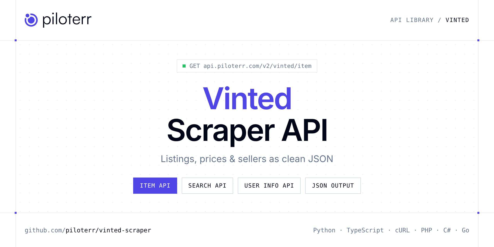

<p align="center">
  <a href="https://www.piloterr.com"></a>
</p>

# Vinted Scraper API

[](https://discord.gg/CFj3ph8aHU) [](https://app.piloterr.com) [](https://app.piloterr.com/openapi) [](LICENSE)

The **Piloterr Vinted Scraper API** lets you extract public data from Vinted as **clean, structured JSON** — no proxies, headless browsers or HTML parsing to maintain. Endpoints available in production:

- **Vinted Item API** — Fetch a Vinted listing by item URL or numeric ID.
- **Vinted Search API** — Search Vinted second-hand listings by keyword or catalog URL across vinted.fr, vinted.com and other domains.
- **Vinted User Info API** — Retrieve public Vinted seller profile by member URL or user ID.

Use it for listing monitoring, price benchmarks, stock sourcing or market analytics on second-hand and vehicle marketplaces.

| Endpoint | Path | Credits | What you get |
|---|---|---|---|
| [Vinted Item API](#vinted-item-api) | `/v2/vinted/item` | 1 | Fetch a Vinted listing by item URL or numeric ID. Parses the public item page (Next.js payload), returns a normalized snake_case object with photos, attributes, shipping, pricing, and optional seller profile. |
| [Vinted Search API](#vinted-search-api) | `/v2/vinted/search` | 1 | Search Vinted second-hand listings by keyword or catalog URL across vinted.fr, vinted.com and other domains. Returns results and pagination. |
| [Vinted User Info API](#vinted-user-info-api) | `/v2/vinted/user/info` | 1 | Retrieve public Vinted seller profile by member URL or user ID. Returns the raw `/api/v2/users/{id}` object |

## Table of contents

- [How it works](#how-it-works)
- [Vinted Item API](#vinted-item-api)
- [Vinted Search API](#vinted-search-api)
- [Vinted User Info API](#vinted-user-info-api)
- [Code examples in other languages](#code-examples-in-other-languages)
- [Practical use cases](#practical-use-cases)
- [Why Piloterr?](#why-piloterr)
- [FAQ](#faq)
- [Related scrapers](#related-scrapers)
- [Support](#support)

## How it works

1. **Create a free Piloterr account** and copy your API key from the [dashboard](https://app.piloterr.com).
2. **Send a `GET` (or `POST`) request** to `https://api.piloterr.com/v2/...` with the header `x-api-key: YOUR_API_KEY`.
3. **Receive structured JSON** — Piloterr handles rendering, proxies, retries and parsing.

```bash
export PILOTERR_API_KEY="your-api-key"
pip install requests        # Python
# TypeScript: Node.js 18+ (native fetch), run with `npx tsx file.ts`
```

> Every endpoint accepts both `GET` (query string) and `POST` (JSON body with the same fields).

## Vinted Item API

Fetch a Vinted listing by item URL or numeric ID. Parses the public item page (Next.js payload), returns a normalized snake_case object with photos, attributes, shipping, pricing, and optional seller profile.

`GET | POST https://api.piloterr.com/v2/vinted/item` · **1 credit per request** · [Full reference](https://app.piloterr.com/openapi)

### Request parameters

| Parameter | Type | Required | Description |
|---|---|---|---|
| `query` | string | ✅ | Vinted item URL or numeric item ID. |
| `region` | string | — | Force the Vinted domain when `query` is a bare item ID only. |

### Python example

```python
import json
import os
import requests

response = requests.get(
    "https://api.piloterr.com/v2/vinted/item",
    headers={"x-api-key": os.environ["PILOTERR_API_KEY"]},
    params={
        "query": "https://www.vinted.com/items/9437210920-purple-prom-dress",
    },
    timeout=60,
)
response.raise_for_status()
data = response.json()

print(json.dumps(data, indent=2, ensure_ascii=False)[:2000])
```

### TypeScript example

```typescript
type VintedItem = {
  id?: number;
  url?: string;
  user?: {
    id?: number;
    city?: string;
    login?: string;
    photo?: {
      id?: number;
      url?: string;
      width?: number;
      height?: number;
    };
    business?: boolean;
    item_count?: number;
    profile_url?: string;
    country_code?: string;
    verification?: {
      email?: Record<string, unknown>;
      google?: Record<string, unknown>;
    };
    country_title?: string;
    feedback_count?: number;
    feedback_reputation?: number;
    positive_feedback_count?: number;
  };
  color?: string;
  price?: {
    amount?: string;
    currency_code?: string;
  };
  title?: string;
  photos?: {
    id?: number;
    url?: string;
    width?: number;
    height?: number;
    is_main?: boolean;
    full_size_url?: string;
  }[];
  status?: string;
  can_buy?: boolean;
  plugins?: {
    favourite?: {
      seller_id?: number;
      is_favourite?: boolean;
      favourite_count?: number;
    };
    breadcrumbs?: {
      brand_id?: number;
      catalog_id?: number;
      breadcrumbs?: Record<string, unknown>[];
    };
    description?: {
      description?: string;
    };
    item_status?: {
      is_draft?: boolean;
      promoted?: boolean;
      is_closed?: boolean;
      is_hidden?: boolean;
      is_reserved?: boolean;
      transaction_permitted?: boolean;
    };
  };
  brand_id?: number;
  category?: string;
  promoted?: boolean;
  seller_id?: number;
  attributes?: {
    size?: {
      id?: number;
      value?: string;
    };
    color?: string;
    status?: {
      id?: number;
      value?: string;
    };
    upload_date?: string;
  };
  catalog_id?: number;
  size_title?: string;
  description?: string;
  instant_buy?: boolean;
  uploaded_at?: string;
  is_favourite?: boolean;
  favourite_count?: number;
  pricing_services?: {
    services?: {
      shipping?: Record<string, unknown>;
      buyer_protection?: Record<string, unknown>;
    };
    total_amount?: {
      amount?: string;
      currency_code?: string;
    };
    original_asking_amount?: {
      amount?: string;
      currency_code?: string;
    };
  };
  shipping_details?: {
    price?: {
      amount?: string;
      currency_code?: string;
    };
    discount?: unknown;
    is_pickup_only?: boolean;
    is_free_shipping?: boolean;
    are_multiple_shipping_options_available?: boolean;
  };
};

const params = new URLSearchParams({
  "query": "https://www.vinted.com/items/9437210920-purple-prom-dress",
});

const response = await fetch(`https://api.piloterr.com/v2/vinted/item?${params}`, {
  headers: { "x-api-key": process.env.PILOTERR_API_KEY! },
});
if (!response.ok) throw new Error(`Piloterr error ${response.status}: ${await response.text()}`);

const data = (await response.json()) as VintedItem;

console.log(JSON.stringify(data, null, 2).slice(0, 2000));
```

<details>
<summary><b>POST variant</b></summary>

```http
POST https://api.piloterr.com/v2/vinted/item
x-api-key: YOUR_API_KEY
Content-Type: application/json

{"query": "https://www.vinted.com/items/9437210920-purple-prom-dress"}
```
</details>

### Output example

Example response from the API reference, abridged — real values depend on the page you scrape.

```json
{
  "id": 9437210920,
  "url": "https://www.vinted.com/items/9437210920-purple-prom-dress",
  "user": {
    "id": 3163220665,
    "city": "CHAMBERSBURG, PA",
    "login": "gingertastic88",
    "photo": {
      "id": 317632205,
      "url": "https://images1.vinted.net/t/01_00734_TjeYgCPBFTM9wAukJhk91fHm/f800/1781705165.webp?s=996d52a34c31e60e6cad8c3ad1d0bd504928d6e8",
      "width": 96,
      "height": 96
    },
    "business": false,
    "item_count": 10,
    "profile_url": "example",
    "country_code": "US",
    "verification": {
      "email": {
        "valid": true,
        "available": true
      },
      "google": {
        "valid": true,
        "available": true,
        "verified_at": "2026-06-17T08:06:05-06:00"
      }
    },
    "country_title": "United States",
    "feedback_count": 1,
    "feedback_reputation": 1,
    "positive_feedback_count": 1
  },
  "color": "Purple",
  "price": {
    "amount": "9.0",
    "currency_code": "USD"
  },
  "title": "Purple prom dress",
  "photos": [
    {
      "id": 39947998424,
      "url": "https://images1.vinted.net/t/03_01b9c_waHhWwt2YUWWt6mHUEY8DPbs/f800/1784471551.webp?s=895a7ec5100a7bc29e98d171869c4c1ab510ac13",
      "width": 600,
      "height": 800,
      "is_main": true,
      "full_size_url": "https://images1.vinted.net/tc/03_01b9c_waHhWwt2YUWWt6mHUEY8DPbs/1784471551.webp?s=e1d11e587899e731615fee24ed0c6cd41d6ab0fe"
    }
  ],
  "status": "New without tags",
  "can_buy": true,
  "plugins": {
    "favourite": {
      "seller_id": 3163220665,
      "is_favourite": false,
      "favourite_count": 0
    },
    "breadcrumbs": {
      "brand_id": 1,
      "catalog_id": 1777,
      "breadcrumbs": [
        {},
        {}
      ]
    },
    "description": {
      "description": "Long purple prom dress, one strap"
    },
    "item_status": {
      "is_draft": false,
      "promoted": true,
      "is_closed": false,
      "is_hidden": false,
      "is_reserved": false,
      "transaction_permitted": true
    }
  },
  "brand_id": 1,
  "category": "Women Prom dresses",
  "promoted": true,
  "seller_id": 3163220665,
  "attributes": {
    "size": {
      "id": 506,
      "value": "S / US 4-6"
    },
    "color": "Purple",
    "status": {
      "id": 50,
      "value": "New without tags"
    },
    "upload_date": "an hour ago"
  },
  "catalog_id": 1777,
  "size_title": "S / US 4-6",
  "description": "Long purple prom dress, one strap",
  "instant_buy": true,
  "uploaded_at": "an hour ago",
  "is_favourite": false,
  "favourite_count": 0,
  "pricing_services": {
    "services": {
      "shipping": {
        "type": "shipping",
        "is_free": true,
        "final_price": {},
        "original_price": {}
      },
      "buyer_protection": {
        "type": "buyer_protection",
        "is_free": false,
        "final_price": {},
        "original_price": {}
      }
    },
    "total_amount": {
      "amount": "10.15",
      "currency_code": "USD"
    },
    "original_asking_amount": {
      "amount": "9",
      "currency_code": "USD"
    }
  },
  "shipping_details": {
    "price": {
      "amount": "0",
      "currency_code": "USD"
    },
    "discount": null,
    "is_pickup_only": false,
    "is_free_shipping": true,
    "are_multiple_shipping_options_available": false
  }
}
```

### Response fields

| Field | Type | Description |
|---|---|---|
| `id` | integer |  |
| `url` | string |  |
| `user` | object |  |
| `user.id` | integer |  |
| `user.city` | string |  |
| `user.login` | string |  |
| `user.photo` | object |  |
| `user.business` | boolean |  |
| `user.item_count` | integer |  |
| `user.profile_url` | string |  |
| `user.country_code` | string |  |
| `user.verification` | object |  |
| `user.country_title` | string |  |
| `user.feedback_count` | integer |  |
| `user.feedback_reputation` | integer |  |
| `user.positive_feedback_count` | integer |  |
| `color` | string |  |
| `price` | object |  |
| `price.amount` | string |  |
| `price.currency_code` | string |  |
| `title` | string |  |
| `photos[]` | object[] |  |
| `photos[].id` | integer |  |
| `photos[].url` | string |  |
| `photos[].width` | integer |  |

## Vinted Search API

Search Vinted second-hand listings by keyword or catalog URL across vinted.fr, vinted.com and other domains. Returns results and pagination.

`GET | POST https://api.piloterr.com/v2/vinted/search` · **1 credit per request** · [Full reference](https://app.piloterr.com/openapi)

### Request parameters

| Parameter | Type | Required | Description |
|---|---|---|---|
| `query` | string | ✅ | Search keyword **or** full Vinted catalog URL. Filters from the URL query string are forwarded to the internal Vinted API. |
| `page` | number | — | Page number. Default `1`. |
| `per_page` | number | — | Results per page. Default `24`. |
| `order` | string | — | Optional sort order. |
| `region` | string | — | Force the Vinted domain when `query` is a keyword only. |

### Python example

```python
import json
import os
import requests

response = requests.get(
    "https://api.piloterr.com/v2/vinted/search",
    headers={"x-api-key": os.environ["PILOTERR_API_KEY"]},
    params={
        "query": "nike",
    },
    timeout=60,
)
response.raise_for_status()
data = response.json()

print(json.dumps(data, indent=2, ensure_ascii=False)[:2000])
```

### TypeScript example

```typescript
type VintedSearch = {
  results?: {
    id?: number;
    url?: string;
    path?: string;
    user?: {
      id?: number;
      login?: string;
      photo?: Record<string, unknown>;
      business?: boolean;
      profile_url?: string;
    };
    photo?: {
      id?: number;
      url?: string;
      width?: number;
      height?: number;
      is_main?: boolean;
    };
    price?: {
      amount?: string;
      currency_code?: string;
    };
    title?: string;
    photos?: {
      id?: number;
      url?: string;
      width?: number;
      height?: number;
      is_main?: boolean;
      image_no?: number;
    }[];
    status?: string;
    item_box?: {
      item_id?: number;
      first_line?: string;
      second_line?: string;
    };
    promoted?: boolean;
    is_visible?: boolean;
    size_title?: string;
    brand_title?: string;
    service_fee?: {
      amount?: string;
      currency_code?: string;
    };
    is_favourite?: boolean;
    content_source?: string;
    favourite_count?: number;
    total_item_price?: {
      amount?: string;
      currency_code?: string;
    };
  }[];
  pagination?: {
    next?: number;
    page?: number;
    per_page?: number;
    total_pages?: number;
    total_results?: number;
  };
};

const params = new URLSearchParams({
  "query": "nike",
});

const response = await fetch(`https://api.piloterr.com/v2/vinted/search?${params}`, {
  headers: { "x-api-key": process.env.PILOTERR_API_KEY! },
});
if (!response.ok) throw new Error(`Piloterr error ${response.status}: ${await response.text()}`);

const data = (await response.json()) as VintedSearch;

console.log(JSON.stringify(data, null, 2).slice(0, 2000));
```

<details>
<summary><b>POST variant</b></summary>

```http
POST https://api.piloterr.com/v2/vinted/search
x-api-key: YOUR_API_KEY
Content-Type: application/json

{"query": "nike"}
```
</details>

### Output example

Example response from the API reference, abridged — real values depend on the page you scrape.

```json
{
  "results": [
    {
      "id": 9417084957,
      "url": "https://www.vinted.com/items/9417084957-tempted-black-draped-cowl-neck-short-sleeve-mini-dress",
      "path": "/items/9417084957-tempted-black-draped-cowl-neck-short-sleeve-mini-dress",
      "user": {
        "id": 3167755373,
        "login": "laceejayy",
        "photo": {},
        "business": false,
        "profile_url": "example"
      },
      "photo": {
        "id": 39862469776,
        "url": "https://images1.vinted.net/t/02_023f8_BqApqrfHRr4eYif4gfmsy9a7/f800/1784247894.jpeg?s=2f0f0b44d41db05b396ceae775aef3c37f8116be",
        "width": 600,
        "height": 800,
        "is_main": true
      },
      "price": {
        "amount": "25.0",
        "currency_code": "USD"
      },
      "title": "Tempted Black Draped Cowl-Neck Short Sleeve Mini dress",
      "photos": [
        {}
      ],
      "status": "Very good",
      "item_box": {
        "item_id": 9417084957,
        "first_line": "tempted",
        "second_line": "S / US 4-6 · Very good"
      },
      "promoted": true,
      "is_visible": true,
      "size_title": "S / US 4-6",
      "brand_title": "tempted",
      "service_fee": {
        "amount": "1.95",
        "currency_code": "USD"
      },
      "is_favourite": false,
      "content_source": "search_promoted_items",
      "favourite_count": 55,
      "total_item_price": {
        "amount": "26.95",
        "currency_code": "USD"
      }
    },
    {
      "id": 9422855356,
      "url": "https://www.vinted.com/items/9422855356-wild-fable-coral-pink-maxi-dress-with-floral-cups-and-open-back",
      "path": "/items/9422855356-wild-fable-coral-pink-maxi-dress-with-floral-cups-and-open-back",
      "user": {
        "id": 3168044178,
        "login": "gabriellamiah",
        "photo": {},
        "business": false,
        "profile_url": "example"
      },
      "photo": {
        "id": 39887137204,
        "url": "https://images1.vinted.net/t/06_00485_DbqyZigqBuvGGQTL4icBDLi5/f800/1784313642.jpeg?s=cf2c907b215da3820cb5abe89e418d934131512c",
        "width": 600,
        "height": 800,
        "is_main": true
      },
      "price": {
        "amount": "12.0",
        "currency_code": "USD"
      },
      "title": "Wild Fable coral pink maxi dress with floral cups and open back",
      "photos": [
        {},
        {}
      ],
      "status": "Very good",
      "item_box": {
        "item_id": 9422855356,
        "first_line": "Wild Fable",
        "second_line": "S / US 4-6 · Very good"
      },
      "promoted": false,
      "is_visible": true,
      "size_title": "S / US 4-6",
      "brand_title": "Wild Fable",
      "service_fee": {
        "amount": "1.3",
        "currency_code": "USD"
      },
      "is_favourite": false,
      "content_source": "search",
      "favourite_count": 52,
      "total_item_price": {
        "amount": "13.3",
        "currency_code": "USD"
      }
    }
  ],
  "pagination": {
    "next": 2,
    "page": 1,
    "per_page": 24,
    "total_pages": 40,
    "total_results": 960
  }
}
```

### Response fields

| Field | Type | Description |
|---|---|---|
| `results[]` | object[] |  |
| `results[].id` | integer |  |
| `results[].url` | string |  |
| `results[].path` | string |  |
| `results[].user` | object |  |
| `results[].photo` | object |  |
| `results[].price` | object |  |
| `results[].title` | string |  |
| `results[].photos[]` | object[] |  |
| `results[].status` | string |  |
| `results[].item_box` | object |  |
| `results[].promoted` | boolean |  |
| `results[].is_visible` | boolean |  |
| `results[].size_title` | string |  |
| `results[].brand_title` | string |  |
| `results[].service_fee` | object |  |
| `results[].is_favourite` | boolean |  |
| `results[].content_source` | string |  |
| `results[].favourite_count` | integer |  |
| `results[].total_item_price` | object |  |
| `pagination` | object |  |
| `pagination.next` | integer |  |
| `pagination.page` | integer |  |
| `pagination.per_page` | integer |  |
| `pagination.total_pages` | integer |  |

## Vinted User Info API

Retrieve public Vinted seller profile by member URL or user ID. Returns the raw `/api/v2/users/{id}` object: login, photo, feedback stats, followers, verification, bundle discounts, and listing counts.

`GET | POST https://api.piloterr.com/v2/vinted/user/info` · **1 credit per request** · [Full reference](https://app.piloterr.com/openapi)

### Request parameters

| Parameter | Type | Required | Description |
|---|---|---|---|
| `query` | string | ✅ | Vinted member profile URL, direct API URL, or numeric user ID. |

### Python example

```python
import json
import os
import requests

response = requests.get(
    "https://api.piloterr.com/v2/vinted/user/info",
    headers={"x-api-key": os.environ["PILOTERR_API_KEY"]},
    params={
        "query": "https://www.vinted.fr/member/123456789-username",
    },
    timeout=60,
)
response.raise_for_status()
data = response.json()

print(json.dumps(data, indent=2, ensure_ascii=False)[:2000])
```

### TypeScript example

```typescript
type VintedUserInfo = {
  id?: number;
  city?: string;
  path?: string;
  about?: string;
  email?: unknown;
  login?: string;
  photo?: {
    id?: number;
    url?: string;
    extra?: Record<string, unknown>;
    width?: number;
    height?: number;
    is_hidden?: boolean;
    temp_uuid?: unknown;
    thumbnails?: {
      url?: string;
      type?: string;
      width?: number;
      height?: number;
      original_size?: unknown;
    }[];
    orientation?: unknown;
    full_size_url?: string;
    is_suspicious?: boolean;
    dominant_color?: string;
    high_resolution?: {
      id?: string;
      timestamp?: number;
      orientation?: unknown;
    };
    dominant_color_opaque?: string;
  };
  locale?: string;
  anon_id?: string;
  city_id?: unknown;
  birthday?: unknown;
  business?: boolean;
  contacts?: unknown;
  currency?: string;
  is_hated?: boolean;
  hates_you?: boolean;
  is_online?: boolean;
  moderator?: boolean;
  real_name?: unknown;
  can_bundle?: boolean;
  country_id?: number;
  fundraiser?: {
    id?: unknown;
    active?: boolean;
    currency?: string;
    percentage?: number;
    feature_disabled?: boolean;
  };
  item_count?: number;
  updated_on?: number;
  profile_url?: string;
  [key: string]: unknown;
};

const params = new URLSearchParams({
  "query": "https://www.vinted.fr/member/123456789-username",
});

const response = await fetch(`https://api.piloterr.com/v2/vinted/user/info?${params}`, {
  headers: { "x-api-key": process.env.PILOTERR_API_KEY! },
});
if (!response.ok) throw new Error(`Piloterr error ${response.status}: ${await response.text()}`);

const data = (await response.json()) as VintedUserInfo;

console.log(JSON.stringify(data, null, 2).slice(0, 2000));
```

<details>
<summary><b>POST variant</b></summary>

```http
POST https://api.piloterr.com/v2/vinted/user/info
x-api-key: YOUR_API_KEY
Content-Type: application/json

{"query": "https://www.vinted.fr/member/123456789-username"}
```
</details>

### Output example

Response shape with placeholder values — field names follow the API reference.

```json
{
  "id": 0,
  "city": "example",
  "path": "example",
  "about": "example",
  "email": "example",
  "login": "example",
  "photo": {
    "id": 0,
    "url": "example",
    "extra": {},
    "width": 0,
    "height": 0,
    "is_hidden": false,
    "temp_uuid": "example",
    "thumbnails": [
      {}
    ],
    "orientation": "example",
    "full_size_url": "example",
    "is_suspicious": false,
    "dominant_color": "example",
    "high_resolution": {
      "id": "example",
      "timestamp": 0,
      "orientation": "example"
    },
    "dominant_color_opaque": "example"
  },
  "locale": "example",
  "anon_id": "example",
  "city_id": "example",
  "birthday": "example",
  "business": false,
  "contacts": "example",
  "currency": "example",
  "is_hated": false,
  "hates_you": false,
  "is_online": false,
  "moderator": false,
  "real_name": "example",
  "can_bundle": false
}
```

### Response fields

| Field | Type | Description |
|---|---|---|
| `id` | integer |  |
| `city` | string |  |
| `path` | string |  |
| `about` | string |  |
| `email` | object |  |
| `login` | string |  |
| `photo` | object |  |
| `photo.id` | integer |  |
| `photo.url` | string |  |
| `photo.extra` | object |  |
| `photo.width` | integer |  |
| `photo.height` | integer |  |
| `photo.is_hidden` | boolean |  |
| `photo.temp_uuid` | object |  |
| `photo.thumbnails[]` | object[] |  |
| `photo.orientation` | object |  |
| `photo.full_size_url` | string |  |
| `photo.is_suspicious` | boolean |  |
| `photo.dominant_color` | string |  |
| `photo.high_resolution` | object |  |
| `photo.dominant_color_opaque` | string |  |
| `locale` | string |  |
| `anon_id` | string |  |
| `city_id` | object |  |
| `birthday` | object |  |

## Code examples in other languages

Ready-to-run examples live in the [`examples/`](examples) folder. Each one reads your key from the `PILOTERR_API_KEY` environment variable.

| Language | Item | Search | User Info |
|---|---|---|---|
| cURL (Bash) | [`item`](examples/curl/item.sh) | [`search`](examples/curl/search.sh) | [`user-info`](examples/curl/user_info.sh) |
| PHP | [`item`](examples/php/item.php) | [`search`](examples/php/search.php) | [`user-info`](examples/php/user_info.php) |
| C# | [`item`](examples/csharp/Item.cs) | [`search`](examples/csharp/Search.cs) | [`user-info`](examples/csharp/UserInfo.cs) |
| Go | [`item`](examples/go/item.go) | [`search`](examples/go/search.go) | [`user-info`](examples/go/user_info.go) |
| Java | [`item`](examples/java/ItemExample.java) | [`search`](examples/java/SearchExample.java) | [`user-info`](examples/java/UserInfoExample.java) |
| Ruby | [`item`](examples/ruby/item.rb) | [`search`](examples/ruby/search.rb) | [`user-info`](examples/ruby/user_info.rb) |
| Node.js | [`item`](examples/nodejs/item.mjs) | [`search`](examples/nodejs/search.mjs) | [`user-info`](examples/nodejs/user_info.mjs) |

## Practical use cases

- **Listing monitoring** — Get alerted when new ads matching your criteria are published.
- **Price benchmarks** — Compute market prices per model, category or location.
- **Sourcing** — Find stock, vehicles, parts or equipment faster than manual browsing.
- **Market analytics** — Measure supply, turnover and pricing trends over time.
- **Data products** — Feed valuation models and dashboards with structured listings.

## Why Piloterr?

- **No infrastructure** — no proxies, headless browsers or CAPTCHA solving to run yourself.
- **Structured JSON** — stable, documented fields instead of brittle HTML selectors.
- **Pay per request** — transparent credit cost per endpoint, failed requests are retried for you.
- **One API key, hundreds of sources** — Vinted plus many other e-commerce, search and company data endpoints in the [Piloterr library](https://www.piloterr.com/library).
- **Any language** — plain HTTPS + JSON, with examples for Python, TypeScript, cURL, PHP, C#, Go, Java, Ruby and Node.js.

## FAQ

### Is it legal to scrape Vinted?

Collecting publicly available data is generally allowed in many jurisdictions, but rules depend on your country, the data you collect and how you use it. Avoid personal data unless you have a lawful basis, respect the website's terms where they apply, and get legal advice for your specific use case. This is not legal advice.

### Do I need proxies or a headless browser?

No. Piloterr handles rendering, proxy rotation and retries on its side. You only send an HTTPS request with your `x-api-key` header and receive JSON.

### How much does a request cost?

Credits per call: `/v2/vinted/item` **1**, `/v2/vinted/search` **1**, `/v2/vinted/user/info` **1**. See the [Piloterr website](https://www.piloterr.com) for plans.

### What data does the Vinted API return?

Each endpoint returns structured JSON: **Vinted Item** — `id`, `url`, `user`, `user.id`, `user.city`, `user.login`; **Vinted Search** — `results[]`, `results[].id`, `results[].url`, `results[].path`, `results[].user`, `results[].photo`; **Vinted User Info** — `id`, `city`, `path`, `about`, `email`, `login`.

### How do I paginate Vinted results?

Use the `page` parameter and keep requesting while the response indicates more results.

### Can I target a specific country or language?

Yes, use `region` — see the parameter tables above for accepted values.

### Which languages are supported?

Any language that can make an HTTP request. This README shows Python and TypeScript; the [`examples/`](examples) folder contains cURL, PHP, C#, Go, Java, Ruby and Node.js.

## Related scrapers

- [AutoScout24 Scraper API](https://github.com/piloterr/autoscout24-scraper)
- [Autotrader Scraper API](https://github.com/piloterr/autotrader-scraper)
- [Copart Scraper API](https://github.com/piloterr/copart-scraper)
- [Kijiji Scraper API](https://github.com/piloterr/kijiji-scraper)
- [Leboncoin Scraper API](https://github.com/piloterr/leboncoin-scraper)
- [Mascus Scraper API](https://github.com/piloterr/mascus-scraper)
- [All Piloterr scrapers on GitHub](https://github.com/piloterr)

## Support

- 💬 Join the [Piloterr Discord](https://discord.gg/CFj3ph8aHU) to ask questions and share what you build.
- 📚 Browse the [API reference (OpenAPI)](https://app.piloterr.com/openapi) and the [Piloterr library](https://www.piloterr.com/library).
- 🔑 [Get your API key](https://app.piloterr.com).

---

<p align="center">
  <a href="https://www.piloterr.com">
    <picture>
      <source media="(prefers-color-scheme: dark)" srcset="images/logo-dark.svg">
      
    </picture>
  </a>
  <br>
  <sub>Built by <a href="https://www.piloterr.com">Piloterr</a> — web scraping APIs for e-commerce, search, real estate and more, one API key.</sub>
</p>

<sub>Vinted is a trademark of its respective owner. This repository is not affiliated with or endorsed by Vinted. Examples are released under the MIT license.</sub>
